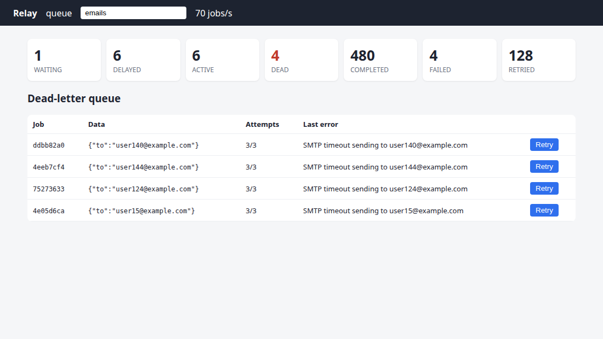

# Relay

A reliable background **job queue on Redis**, written from scratch in TypeScript: atomic
Lua scripts, worker leases with heartbeats, retries with exponential backoff and jitter,
a dead-letter queue, idempotent enqueue, graceful shutdown, an HTTP API and a live
dashboard. Same idea as BullMQ, Sidekiq or Celery, small enough to read in one sitting.



**Stack:** TypeScript, Node.js, Redis (Lua scripting, lists, sorted sets), ioredis,
Express 5, Zod, Vitest + Supertest, Docker Compose, GitHub Actions.

## Results

Measured on a laptop (Ryzen 5 5500U, Redis 7 in Docker):

| benchmark | result |
|---|---|
| throughput, 50,000 no-op jobs, 4 worker processes × 16 concurrency | **~13,000 jobs/s** processed, ~28,000 jobs/s enqueued |
| chaos: 20,000 jobs, a random worker **SIGKILLed every 0.7 s** (21–23 kills per run) | **0 jobs lost**; 1–7 jobs ran twice (expected: at-least-once) |

The chaos test (`bench/chaos.ts`) gives killed workers no chance to clean up. Their
jobs are recovered when the lease expires. It also runs in CI and fails the build if any
job is lost.

## How it works

```
 producer ──enqueue──► waiting (LIST) ──claim──► active (ZSET, score = lease expiry) ──complete──► done (TTL 24 h)
                          ▲    ▲                     │            │
                          │    │ due                 │ fail       │ lease expired (worker died)
                          │  delayed (ZSET, score = run-at) ◄─────┘ attempts left      │
                          │                          │ no attempts left                │
                          └──── requeue ─────────────┼─────────────────────────────────┘
                                                     ▼
                                               dead (LIST) ──retry from dashboard──► waiting
```

- **Atomic state changes.** Each transition (enqueue, claim, complete, fail, extend, reap) is
  one Lua script, and Redis runs a script without interleaving other commands. Claiming
  pops from `waiting` and adds to `active` in one step, so two workers can never get the
  same job (tested with 250 concurrent claims).
- **Leases instead of trust.** A claimed job has a lease (`active` sorted set, score = expiry).
  Workers send a heartbeat every lease/3 while the handler runs. If a worker dies, its
  lease expires and a reaper (every worker runs one; the script is atomic) puts the job
  back in line.
- **Fencing tokens.** Each claim gets a random token, which `complete` and `fail` must
  present. When a lease is reaped the token is deleted, so a worker that was only slow
  (GC pause, network hiccup) and comes back later can't overwrite the result of the
  worker that took over.
- **Retries:** exponential backoff with full jitter, `random(0, base · 2^(attempt-1))`, capped.
  Jitter spreads retries out after an outage, so jobs don't all retry at the same moment
  (thundering herd). The delay is computed in Node because `math.random` inside Redis
  scripts is deterministic.
- **Dead-letter queue:** a job that uses up `maxAttempts` (including crashes) goes to `dead`
  with its last error, and can be retried from the dashboard or API.
- **Idempotent enqueue:** an optional `idempotencyKey` is stored with `SET NX`-style logic in
  the enqueue script; a duplicate request returns the original job id (`200` instead of `201`).
- **Delivery guarantee: at-least-once.** A job can run twice if a worker dies after doing
  the work but before acknowledging it, so handlers should be idempotent. Exactly-once
  delivery isn't possible across a network without the handler's cooperation.
- **Graceful shutdown:** on SIGTERM a worker stops claiming and waits for in-flight jobs
  (bounded by a timeout; anything left over is recovered by lease expiry).
- **Redis Cluster ready keys:** all keys of a queue share the `{queue}` hash tag, so they
  live in one slot and multi-key scripts work.

## Run it

```bash
docker compose up -d --build      # Redis (AOF on), API + dashboard on :3000, 3 demo workers
curl -X POST localhost:3000/queues/emails/jobs -H 'content-type: application/json' \
     -d '{"data": {"to": "a@example.com"}, "maxAttempts": 3}'
open http://localhost:3000        # dashboard
```

The demo worker fakes sending email: 20–200 ms per job, with 20% of jobs failing.

### Library use

```ts
const queue = new Queue("emails", new Redis(), { leaseMs: 30_000 });
await queue.enqueue({ to: "a@example.com" }, { maxAttempts: 5, idempotencyKey: "welcome-42" });

const worker = new Worker(queue, async (data) => sendEmail(data.to), { concurrency: 8 });
worker.start();
process.on("SIGTERM", () => worker.stop());
```

### Tests and benchmarks

```bash
docker run -d -p 6390:6379 redis:7
REDIS_URL=redis://127.0.0.1:6390 npm test                     # 18 tests against real Redis
REDIS_URL=redis://127.0.0.1:6390 npx tsx bench/throughput.ts 50000 4 16
REDIS_URL=redis://127.0.0.1:6390 npx tsx bench/chaos.ts 20000 4 700
```

## HTTP API

| Method | Path | |
|---|---|---|
| POST | `/queues/:queue/jobs` | `{ data, maxAttempts?, delayMs?, idempotencyKey? }` → `201 {id}` (`200` if deduplicated) |
| GET | `/queues/:queue/jobs/:id` | state, attempts, last error, result |
| GET | `/queues/:queue/stats` | waiting / delayed / active / dead / completed / failed / retried |
| GET | `/queues/:queue/dead?limit=` | dead-letter jobs |
| POST | `/queues/:queue/dead/:id/retry` | move back to waiting with attempts reset |
| GET | `/health` | `503` if Redis is unreachable |

## Layout

```
src/scripts.ts   the Lua scripts: every state transition, atomic
src/queue.ts     Queue: enqueue, claim, complete, fail, extend, reap, stats
src/worker.ts    Worker: claim loops, heartbeats, reaper, graceful shutdown
src/api.ts       Express API + static dashboard (public/index.html)
bench/           throughput and chaos benchmarks
test/            queue semantics (with a fake clock), worker behaviour, HTTP API
```

## Limits

When the queue is empty, workers poll (starting at 10 ms, backing off to 500 ms) rather
than block, so a job enqueued into an idle queue can wait up to ~0.5 s to be picked up. No job priorities or cron schedules.
Durability is whatever Redis is configured for: AOF with `everysec` can lose about 1 s of
writes if Redis itself crashes.
